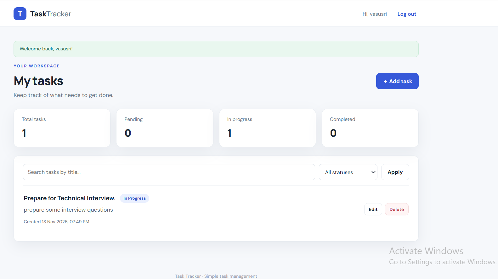

# Task Tracker

A beginner-friendly Task Tracker built with core PHP, MySQL, HTML, CSS and JavaScript, based on the RTIH Intern – IT technical assignment.

## Features

### Level 1 – Basic task management
- Create tasks with a title and optional description.
- View the signed-in user's tasks.
- Edit task title, description and status.
- Delete tasks after a browser confirmation.
- Success and error messages.

### Level 2 – Status, search and validation
- Statuses: Pending, In Progress and Completed.
- Search tasks by title.
- Filter tasks by status.
- Browser-side required fields and server-side validation.

### Level 3 – Login, authorization and security
- User registration and login.
- Passwords stored with `password_hash()` and checked with `password_verify()`.
- Dashboard requires an authenticated session.
- Each task is linked to its owner. Every read, update and delete query checks `user_id` on the server.
- PDO prepared statements for database queries.
- Output escaped with `htmlspecialchars()`.
- CSRF tokens protect all state-changing forms.
- Session ID regenerated after successful login/registration; session cookies use HttpOnly and SameSite=Lax.

### Optional bonus
- Dashboard summary showing total, pending, in-progress and completed task counts.

## Requirements
- XAMPP (Apache, PHP 8+, MySQL/MariaDB).
- PHP PDO MySQL extension enabled.
- A modern browser.

## Setup on XAMPP (Windows)
1. Extract the ZIP file.
2. Copy the `task-tracker` folder into `C:\\xampp\\htdocs\\`.
3. Start **Apache** and **MySQL** in the XAMPP Control Panel.
4. Open `http://localhost/phpmyadmin/`.
5. Select **Import**, choose `task-tracker/database.sql`, then click **Import/Go**. The SQL file creates `task_tracker_db`, `users` and `tasks`.
6. Open `config/database.php`. The default local XAMPP values are host `127.0.0.1`, database `task_tracker_db`, user `root`, and an empty password. Change these values if your MySQL setup differs. Do not use these development defaults on a public server.
7. Open `http://localhost/task-tracker/` in your browser.
8. Choose **Create account**, register with your own email and a password of at least 8 characters, then add tasks.

There is no pre-created test account and no shared password. Register a local account through the application.

## Database design
- `users`: one row per registered user; email is unique; password is stored only as a hash.
- `tasks`: one row per task; `user_id` references `users.id`; deleting a user cascades to their tasks.
- Relationship: one user can own many tasks (one-to-many).
- Authorization rule: all registered accounts have the same role/permission level. A user can only list, view, update or delete tasks whose `user_id` matches their authenticated session. No administrator role is required by the assignment; ownership is the access-control rule implemented here.

## Test cases
Run these manually after setup and record the actual result on your machine.

| # | Test | Expected result |
|---|---|---|
| 1 | Open dashboard while logged out | Redirected to login |
| 2 | Register with valid details | Account created and dashboard opens |
| 3 | Register with an existing email | Friendly duplicate-email error |
| 4 | Log in with wrong password | Generic login error; no account details exposed |
| 5 | Add task with title and description | Task appears in the list |
| 6 | Submit an empty title | Server rejects it with a friendly message |
| 7 | Edit a task | Updated values appear |
| 8 | Change status | Selected status is saved and displayed |
| 9 | Search by part of a title | Matching tasks only |
| 10 | Filter by status | Tasks with selected status only |
| 11 | Delete a task and confirm | Task is removed |
| 12 | Try to edit/delete another user's task by changing the ID | Task is not found or operation is denied |
| 13 | Inspect database password field | A password hash, not plain text, is stored |
| 14 | Submit a state-changing form without a valid CSRF token | Request is rejected |
| 15 | Enter HTML/script text in a task title | It is displayed as text, not executed |

## Backup and restore
**Backup:** In phpMyAdmin, select `task_tracker_db` → **Export** → choose SQL → **Go**. Store the downloaded `.sql` file securely.

**Restore:** In phpMyAdmin, create/select the target database and use **Import** to import the backup SQL file. The supplied `database.sql` is the initial schema; an export made later contains the user's actual task data.

## Deliverables checklist
- [x] Source code
- [x] SQL schema export
- [x] Setup instructions and database configuration notes
- [x] Role/ownership explanation
- [x] Manual test plan
- [x] Backup/restore explanation
- [x] AI tool usage note
- [ ] Add your own screenshots after running the app (see `screenshots/README.txt`)
- [ ] Fill in actual test results and known limitations before submission

## Known limitations
- No password reset or email verification.
- No pagination; the assignment lists pagination only as an optional bonus.
- No automated PHPUnit/Postman suite is included.
- The app is intended for local demonstration. A public deployment needs production-grade secrets management, HTTPS, server hardening and additional operational controls.

## AI coding assistant disclosure
This project was prepared with assistance from ChatGPT. Review the code before submission and be ready to explain it. One example of a review/change to document after your own review: verify that task update and delete queries include both the task ID and the logged-in user's ID, so changing a URL/request ID cannot modify another user's task. Only claim this review change after you have personally checked it.

## Dashboard Screenshot

